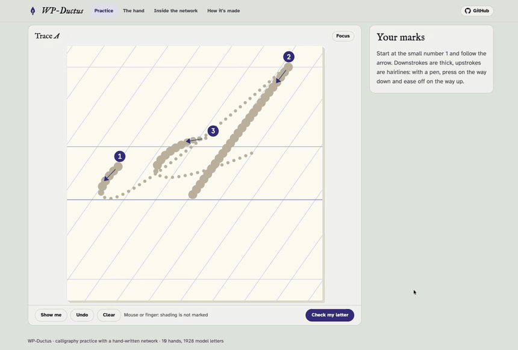

<p align="center">
  
</p>
<h1 align="center">WP-Ductus</h1>
<p align="center"><em>Learn calligraphy with a network whose weights were written by hand</em><br><a href="https://heldernoid.github.io/WP-Ductus/">heldernoid.github.io/WP-Ductus</a></p>

A calligraphy teacher whose network was **written by hand**, not trained. You choose one of ten hands (fourteen styles) and write a letter or a text; a small
Siamese network compares your strokes with the model letter and marks the **shape** (did you follow the path), the
**ductus** (did each stroke run the right way, in the right order), the **shading** (thick downstrokes, thin
hairlines) and, when you copy by eye, the **form** (slant and size). Every one of its 191 edit lines was typed with a
reason. Nothing was trained or fitted.

*Ductus* is the calligrapher's word for the order, direction and movement of a letter's strokes.



## Try it

**[heldernoid.github.io/WP-Ductus](https://heldernoid.github.io/WP-Ductus/)**. Two games, with up to three stars per
letter in each:

1. **Trace the dots.** Write over the dotted model. Numbers and arrows show where each stroke starts and which way it
   runs; bigger dots mean press harder. Ink within 2 px (about 8 screen pixels) of the dots counts as on the path.
2. **Copy by eye.** Write freehand beside the model, anywhere on your sheet. Your letter is fitted onto the model
   (place, size and slant) before it is marked, so shape and ductus mark how precisely you wrote the strokes, not
   whether they landed on an expected spot. A fourth mark, **form**, says how your slant and size compare with the
   model's; where you wrote is not marked. With lines, the model sits beside your sheet row for row (above it on a
   narrow screen), so each model row is level with the row you copy it into.

Both games work with **one letter** or with **lines of text**: pick a phrase (from the minim word *minimum* to a
pangram) or type your own, and it is laid out on as many rows of guidelines as it needs. You may join the letters or
lift between them. Each letter is marked on its own by the same network, and the line's score is the mean; the tip
names the weakest letter and its costliest fault.

The page has four views. **Practice** is where you play: pick the game, then **Letters** (tabs for small letters,
capitals, digits, accents) or **Text**. Text is a notebook: type, paste or upload a `.txt` file (line breaks kept, up
to 4000 characters), and it is laid out on ruled pages with a margin line, as many rows a page as fit your screen; check each page when
you finish it. The report on the whole text then shows the overall marks, every word coloured by its score, your weakest
letters (each with a *Practise* button), the points lost to each kind of fault, the three things to work on next and,
in the copy game, how steady your slant and size are. Any text or letter downloads as a **PDF template**: a tracing
sheet (the model in dots) or a copybook (a model row, then an empty row). **The hand** describes the chosen hand, with the
whole alphabet (tap a letter to practise it); **Inside the network** shows the maps and numbers behind any letter you
pick; **How it's made** explains the method and links this log.

*Show me* writes the letter for you. After a check, the colours on the sheet show where the points went (off the path,
missed, written backwards, wrong pressure; in the copy game the model is shown faintly as it stands on the guidelines, its own size, slant and height, moved sideways beside your letter, with what you missed marked on it), the tip names the costliest fault,
and *Inside the network* shows the maps it compared and every number behind the marks. The page also describes the
hand: its history, tools, slant, proportions, shading and the basic strokes, drawn from the model letters.

On a tablet or a laptop with a stylus: the first pen stroke turns on *Pen only* (a palm or finger on the sheet is
ignored; tap the button to allow fingers again), the tools stay at the bottom of the screen while the sheet is on it
(with your score once checked), buttons grow for touch, and *Focus* hides everything but the sheet and the marks.
In focus, *Lock* holds the page still under your hand (no scrolling, zooming or bounce) and lets only the pen write.
For a text, *A−* and *A+* set the size of the writing (four sizes), and a page has as many rows as fit the screen.

With a pen that reports pressure (a stylus on a tablet), shading is marked too. With a mouse or a finger there is no
pressure, so the overall score is 60% shape and 40% ductus.

## What it covers

Ten hands (fourteen styles), the ones commonly taught to beginners. Each letter is pen strokes in
writing order (never a font: fonts have outlines, not strokes, order or direction), authored for that hand from its
exemplar sheets: the sheet measured first (x-height in nib widths, extenders, capital height, slant, nib angle, the
width of each letter), then every row compared with the letters at the same size (`eval/compare.py`), never traced.
Every hand has the same alphabet: a–z, A–Z, 0–9 and the accented letters that fit the page.

| Hand | Pen | Slant | Exemplar and what its letters follow |
|---|---|---|---|
| Copperplate | pointed | 55° | a copperplate exemplar sheet: capitals 2.5 x-heights with the capital stem, ovals and looped entries; long entry hairlines |
| Spencerian | pointed | 52° | *Theory of Spencerian Penmanship* (1874): measured in spaces (short letters 1, loops 3 up and 2 down), narrow ovals |
| Modern | pointed | 25° | a modern calligraphy a–z: compressed letters, long narrow loops, a little bounce |
| Italic | broad nib 35° | 10° | an italic exemplar sheet and Arrighi: arches from high on the stem, two-part a d g q, wide swash capitals |
| Foundational | broad nib 30° | upright | a foundational exemplar sheet: 4 nib widths, round o, wedge serifs, two-storey g; Johnston's capitals |
| Roman: Capitalis | broad nib 27° | upright | "La capital romana": the classical widths, pen-made serifs, R's sweeping leg, Q's long tail; unicase |
| Roman: Rustica | broad nib 60° | upright | "La Rustica" (5th century): thin stems, heavy wedge feet, wavy arms, B F H L above the line; unicase |
| Uncial | broad nib 25° | upright | an uncial exemplar sheet: wide round forms at 4 nib widths, flagged stems, its stroke order; unicase |
| Blackletter: Textura | broad nib 40° | upright | Textura Quadrata: stems a stem apart, diamond heads and feet, wide capitals with doubled stems |
| Blackletter: Bâtarde | broad nib 40° | 8° | "La gothique bâtarde": 3 nib widths, flat-roofed arches, Burgundian capitals |
| Blackletter: Fraktur | broad nib 45° | upright | a Fraktur exemplar sheet: bitten round letters, forked ascenders, elephant-trunk capitals |
| Blackletter: Rotunda | broad nib 30° | upright | the Rotunda sheet: wide and round, short extenders, 4 nib widths |
| Gothicized Italic | broad nib 35° | upright | a gothicized italic exemplar sheet: forked ascenders, pointed arches, blackletter capitals with hairline decorations |
| Neuland | square-cut pen | upright | a Neuland exemplar sheet (after Rudolf Koch, 1923): blocky, angular capitals; unicase |

Roman Capitals, Rustica, Uncial and Neuland are unicase: one set of forms, so a small letter is written as its
capital. Where a hand is simplified, its description on the page says how: a broad nib here keeps one angle, so the
turned pen of Roman N and M, Rustica's 45° curves and Uncial's N is not modelled, and the thin vertical hairlines of
the Textura capitals are left out; Neuland's pen is one even width, so its stems are lighter than Koch's to keep the
counters open; figures that the exemplars do not show are written in the manner of the hand, and say so.

A pointed pen's width follows pressure, which the pointed-pen rule gives to downstrokes along the slant. A broad
nib's width follows the direction: the nib's width times the sine of the angle between the stroke and the nib's
edge, so the model letters, your strokes and the page's drawing (the shape the nib sweeps) all follow one rule.
Shading is marked only for the pointed hands: with a broad nib the width comes from the direction, and a stylus does
not report how the nib is held.

## How it works

```
model letter strokes ──render──▶ maps ──┐
                                        ├─▶ shared hand-written layers ─▶ comparison ─▶ counts ─▶ measures ─▶ marks + tip
your strokes ─────────render──▶ maps ──┘
```

1. **Render** (`ductus/render.py`): strokes become 96 × 96 maps: ink (anti-aliased), pen width, writing time (0 at the
   start of the letter, 1 at the end) and direction (down, up, left, right). Model and attempt go through the same
   code: that is the Siamese part.
2. **Encoder (E1, E2)**, the same weights for both: solid ink, shaded ink (pen wider than 2.25 px), the model's
   hairlines.
3. **Tolerance band (B1, B2)**: maps widened by 2 px (max over 3 × 3, twice); the model's direction and shading by
   1 px only.
4. **Comparison (C1, C2)**: pixel maps, each an AND or AND-NOT written as `clip(a + b − 1)`: your ink on / off the
   path, model ink covered / missed, the same / the opposite direction, written much earlier / later than the model,
   shaded where the model is shaded, thick where the model is a hairline.
5. **Counts (Z) and measures (R)**: pixel sums, then six fixed ratios: `stay`, `cover`, `direction`, `order_slip`,
   `shade_hit`, `hair_slip`.
6. **Marks (Q, O)**: `shape = stay + cover − 1`, `ductus = 1.5 direction − 1.5 order_slip − 0.5`,
   `shading = 0.7 shade_hit − 0.7 hair_slip + 0.3` (each clipped to 0–1); overall 50 / 30 / 20 with pressure,
   60 / 40 without.
7. **Faults (F)**: how many points each fault cost; the page's tip names the largest.
8. **Copy game only**: before rendering, your letter is **fitted** onto the model (`fit` in `ductus/render.py`):
   centred, then rounds of matching points both ways (yours to the nearest model point and the model's to the nearest
   of yours), keeping the best 80% each way, and solving for the size, slant and place that bring the pairs nearest,
   with a gentle pull toward your own size and slant. Trimming both ways lets a stray mark and a stroke you left out
   go unmatched instead of pulling the fit. The band widens to 4 px (the loop count of B2 is an input). Z2 / R2
   measure form on the thin-pen path before the fit, where yours and the model's lie within 3 px of each other once
   fitted: the slope of x on y (slant) and the variance in y (size), each against the model's. Faults `f_upright`,
   `f_slanted`, `f_big`, `f_small` (first 4° and 10% free, silenced by twice the share of the model you missed) make
   the **form** mark; overall 40 / 30 / 15 / 15 with pressure, 45 / 35 / 0 / 20 without.

9. **Lines of text** (`web/lines.js`, page logic with no weights): letters are placed side by side in the upright
   frame, so that one letter's exit hairline (almost) meets the next one's entrance, and rows wrap at word gaps. What
   you write is cut at the slanted boundaries between letters (a joined stroke is cut where it crosses one, and the
   cut point goes to both sides) and each piece goes through steps 1–8 as a single letter. In the copy game your row's
   spacing may differ from the model's, so the boundaries are found first: the ink profile of your row (path length
   per pixel column in the ascender, x-height and descender zones) is matched to the model row's by dynamic time
   warping, and each model boundary goes where its column landed.

## How the weights were checked

No handwriting dataset is needed: the model letters are exact, so the network is tested by damaging a perfect copy in
known ways and requiring the right mark to fall (`eval/ladder.py`, `tests/`). Mean over copperplate's 36 characters
(a–z, 0–9); every other hand passes the same perfect-copy and damage checks in `tests/test_styles.py`:

| Attempt | Shape | Ductus | Shading | Overall (pen) | Overall (mouse) |
|---|---:|---:|---:|---:|---:|
| perfect copy | 100 | 100 | 100 | 100 | 100 |
| shifted 2 px (8 screen px) | 100 | 99 | 99 | 100 | 100 |
| shifted 4 px | 85 | 75 | 81 | 81 | 81 |
| shifted 6 px | 43 | 25 | 50 | 39 | 36 |
| wobble 1 px | 100 | 99 | 100 | 100 | 100 |
| wobble 3 px | 91 | 81 | 91 | 88 | 87 |
| first stroke written backwards | 100 | 12 | 100 | 74 | 65 |
| strokes in the wrong order | 100 | 75 | 100 | 93 | 90 |
| no shading (constant 1.8 px) | 100 | 100 | 30 | 86 | 100 |
| everything thick (4 px) | 100 | 99 | 30 | 86 | 100 |
| last stroke missing | 70 | 83 | 89 | 78 | 75 |
| a stray stroke | 90 | 100 | 100 | 95 | 94 |

Wrong order counts for single-stroke characters as 100 (there is no order to get wrong), which lifts that row's mean.

Copy game, same characters (form = slant and size):

| Attempt | Shape | Ductus | Shading | Form | Overall (pen) | Overall (mouse) |
|---|---:|---:|---:|---:|---:|---:|
| perfect copy | 100 | 100 | 100 | 100 | 100 | 100 |
| perfect copy moved 12 px right and 8 px down | 100 | 100 | 100 | 100 | 100 | 100 |
| wobble 3 px | 100 | 87 | 94 | 96 | 95 | 94 |
| 13° more upright | 100 | 99 | 100 | 19 | 88 | 84 |
| 10° more slanted | 99 | 93 | 94 | 24 | 85 | 82 |
| 0.8 × size | 100 | 100 | 100 | 64 | 95 | 93 |
| 1.25 × size | 100 | 100 | 100 | 58 | 94 | 92 |
| first stroke reversed | 100 | 13 | 100 | 100 | 74 | 70 |
| last stroke missing | 83 | 83 | 84 | 78 | 83 | 82 |
| a stray stroke | 89 | 97 | 99 | 92 | 93 | 92 |

Slant and size now cost only form: shape and ductus stay at the precision of the strokes.

Lines (`tests/lines.mjs`; four phrases at two sheet widths, lowest letter of each):

| Attempt | Trace | Copy |
|---|---:|---:|
| perfect copy, letter by letter | 100 | 100 |
| perfect copy, letters joined into words | 99.4 | 99.4 |
| copy: rows moved 9 px, spaced 12% wider | | 99.8 |
| copy: gaps between letters 0, 2.5 or 5 px wider in turn | | 99.4 |

Writing one letter's first stroke backwards lowers that letter below 90 and leaves every other letter at 100.

The browser engine (`web/ductus.js`) gives the same numbers as the Python one to 1e-9 (`tests/test_parity.py`).

## Run it

```bash
python3 -m venv .venv && .venv/bin/pip install -r requirements.txt
.venv/bin/python gen/generate.py           # write arch.json, weights/ductus.edits and web/model/
.venv/bin/python -m pytest -q tests        # both games: perfect copies, ladders, tips, JS parity (needs node)
.venv/bin/python eval/ladder.py nau        # the distortion table for some letters
.venv/bin/python eval/sheet.py sheet.png all italic        # a hand's model letters on guidelines
.venv/bin/python eval/compare.py out.png italic abc         # as the page draws them (add an exemplar crop to compare)
cd web && python3 -m http.server           # the demo at http://localhost:8000
```

## Edit-list format

One edit per line, `#` starts the reason:

```
TAP   <layer> <out> <in> <dy> <dx> <value>        conv kernel tap
BIAS  <layer> <out> <value>                       bias (every BIAS line carries its reason)
ZONE  <layer> <feat> <in> <rows> <cols> <scale>   sum of a map over a region
LINK  <layer> <out> <in> <value>                  one weight of a linear layer
```

`arch.json` lists the layers and their named inputs and outputs; the `ratio` layer is a fixed op with no weights.

## Files

| Path | What |
|---|---|
| `gen/copperplate.py` | the copperplate letters as pen strokes (basic strokes: entrance, stem, underturn, overturn, arch, oval, loops) |
| `gen/styles.py` | builds every hand: guidelines, pens, accents, the unicase aliases |
| `gen/hands/` | one module a hand (`letters()` and `HAND`), the hand's own letterforms |
| `gen/pen.py` | drawing helpers shared by the hands (Bézier, arc, broken line) |
| `gen/generate.py` | writes the network: every layer and edit line, with reasons |
| `weights/ductus.edits`, `arch.json` | the network |
| `ductus/engine.py`, `ductus/render.py` | the engine and the renderer |
| `web/` | the demo page: `index.html` (markup and style), `app.js` (the page), `ductus.js` (the same engine and renderer in JavaScript), `lines.js` (lays text out in rows and pages, cuts writing into letters), `report.js` (the report on a whole text), `pdf.js` (the PDF templates, written without a library) |
| `eval/` | `ladder.py` (distortion table), `sheet.py` (model letter sheet), `compare.py` (letters under an exemplar crop at the same x-height) |
| `tests/` | the checks above |
| `LOG.md` | how the weights were written: decisions, what did not work |
| `AGENTS.md` | how to work on it: house rules, architecture, how to add a letter or a style |

## Credits

The weights, the model letters and the code were written by Claude Opus 5.5 (Anthropic), working with the project's
author. Sister project: [WP-CharNet](https://github.com/heldernoid/WP-CharNet), a handwritten-character classifier
built the same way.

## Known limits

- **No punctuation yet**, and one form of each letter (no alternates or swash variants beyond the exemplar's).
  Accented capitals are left out where the accent would leave the page (copperplate's 2.5 x-height capitals, the
  larger broad-nib hands).
- **Lines are marked letter by letter.** Letters sit side by side with their hairlines meeting, not with authored
  joining strokes, and nothing marks spacing, the evenness of slant along a line, or the baseline drift of a row.
  Lines exist only in the browser (`web/lines.js`); the Python side marks single letters.
- **Copy-game lines need roughly the model's letters.** If you leave a letter out or add one, the profile matching
  shifts the boundaries around it and the neighbours lose points too.
- **Position matters in the trace game.** Your ink is judged against the dots where they are; 2 px (about 8 screen
  px) of drift is free, 4 px costs about 20 points. In the copy game it does not matter at all.
- **The copy-game fit can be fooled by a letter with a large part missing**: it may stretch what you wrote over more
  of the model. The pull toward your own size limits it, and a missing part costs shape and silences form, but a half
  letter is not marked as cleanly as a whole one.
- **Copy-game ductus needs a close shape.** Direction is compared where your path lies within 1 px of the model's; a
  copy whose strokes cross the model's other strokes can be marked backwards there.
- **Pressure mapping is a guess.** Pen pressure 0.2 → hairline, 0.65 and up → full shade; pens differ.
- **The model letters are one writer's version of each hand**: authored from the exemplar sheets and measured against
  them, not traced, so they follow one exemplar's forms where scribes vary. A broad nib keeps one angle per hand (no
  turned pen, no strokes made with the nib's corner).

## License

MIT, see `LICENSE`.
